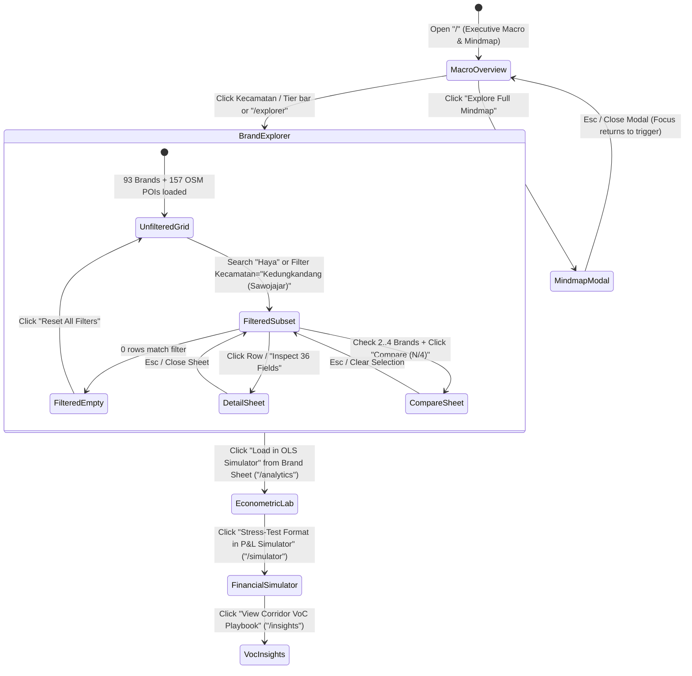

# DESIGN: Malang Coffee Shop & Kopi Susu Market Intelligence Dashboard (UI/UX & Interaction Contract)

Status: Accepted
Version: 2.0.0
Surface Owners: `admin-product-ux` (workflow & interaction contracts) + `admin-dashboard` (hierarchy, clean-light baseline, density) + `shadcn-ui` (Astro/React component boundaries)
Linked PRD: `PRD.md` | Linked PLAN: `PLAN.md` | Linked Tasks: `TASKS.md`

---

## 1. Operational Frame & Product UX Model (`admin-product-ux`)

### 1.1 Actors, Operational Jobs & Decision Risk

| Role | Primary Operational Job | Trigger & Frequency | Decision Risk & Failure Cost | Time Pressure | Completion Condition |
|---|---|---|---|---|---|
| **F&B Investor / Owner** | Evaluate Capex (`Rp65M–Rp680M`), 12-month academic-calendar cashflow resilience, and payback period before signing a lease in Malang | Pre-investment evaluation; 3–10 sessions per site candidate | **High (`Rp65M–Rp680M` capital at risk):** Ignoring July–August / January–February student exodus (`-25%` to `-35%` volume) or over-sizing seating capacity causes 12+ month payback slippage | Medium (1–2 weeks due diligence window) | Selected archetype + corridor passes P10/P50 cashflow stress test with documented payback month |
| **Franchise Expansion Lead** | Benchmark 93 incumbent brands and 157 OSM cafe nodes across 5 Kecamatan + 3 border corridors to pick underserved micro-corridors | Weekly corridor scouting & competitor benchmarking | **High:** Opening inside a saturated 500m campus red-ocean without 24H differentiation or brand moat | High (active lease negotiations) | Shortlist of 2–4 benchmark brands compared side-by-side (`Compare Sheet`) and exported to CSV/JSON |
| **Coffee Shop Operator / Store Manager** | Optimize Kopi Susu dine-in vs GoFood/ShopeeFood pricing, promo co-pay ceiling, BOM COGS grammage, and seat-hour monetization (`RevPASH`) | Monthly menu re-pricing & campaign evaluation | **Medium–High:** Uncalibrated `20% + Rp1,000` platform fee + promo co-pay erodes net cup margin below `Rp4,000` (`< 35%`) | Immediate (live promo toggle decisions) | Optimal app markup % and BOM COGS locked with green (`>= 65%` gross / `>= 50%` net delivery) margin status |
| **Market Research Analyst** | Audit, cross-filter, and export the 36-column telemetry matrix, OLS elasticities ($R^2 = 0.7407$), and 48,000+ review NLP sentiment | Ad-hoc deep-dive analysis | **Low–Medium:** Misaligned filter state or unquoted CSV export corrupting downstream modeling | Low | Filtered subset exported cleanly with URL-reproducible query state |

### 1.2 Canonical Business Objects & State Lifecycle

| Business Object | Canonical Source | Key Relationships | Interactive States in UI |
|---|---|---|---|
| **Brand Record (`93` brands / `176` outlets)** | `malang_coffee_master_93_brands.json` | Belongs to `1` Kecamatan, `1` Category Tier (`Tier 1..6`), nearest `1` of `9` Universities | `Unfiltered` -> `Filtered Match` -> `Row Hovered` -> `Inspected (36-Col Detail Sheet)` -> `Pinned for Comparison (1..4 max)` -> `Exported` |
| **Geospatial Node (`93` Brands + `157` OSM POIs + `9` Campuses)** | `malang_osm_157_named_pois.json` + `malang_universities_9_anchors.json` | Linked by WGS84 coordinates & Haversine distance (`km`) | `Layer Visible / Hidden` -> `Cluster / Radius Filtered` -> `Marker Selected (Popover Active)` |
| **OLS & RevPASH Scenario** | `src/lib/engines/ols-demand.ts` | Seeded by Brand Preset (e.g., *Haya Espresso Bar*, *Pesenkopi Plus*, *Jokolet*) or custom user sliders | `Preset Baseline` -> `Dirty (Custom Sliders)` -> `Diagnosed (RevPASH Danger / Healthy / High-Velocity)` -> `URL Synced` |
| **12-Month Monte Carlo & Delivery Scenario** | `src/lib/engines/monte-carlo-pnl.ts` + `delivery-margin.ts` | Seeded by Archetype (`Format A/B/C/D`) + Corridor Type (`Campus` vs `Neighborhood Commuter`) | `Archetype Default` -> `Custom Parameterized` -> `Margin Warning / Viable` -> `URL Synced` |

### 1.3 End-to-End User Journey & State Machine (`stateDiagram-v2`)



---

## 2. Clean-Light Operator Visual Baseline & Anti-Slop Rules (`admin-dashboard`)

Following `clean-light-cms-baseline.md`, the UI uses a **clean-light operator baseline** optimized for high-density numerical scanning, zero visual fatigue, and strict WCAG AA contrast. *(Dark mode is an explicit deferral per `admin-dashboard` baseline rules so light-polarity tabular scanning remains crisp and unambiguous).*

### 2.1 Strict Anti-Slop Mandates
- **NO gradients or glassmorphism:** Flat, opaque surfaces (`#fcfcfc` app shell, `#ffffff` cards/tables). No `backdrop-filter: blur()`.
- **NO oversized border radii:** `6px` (`rounded-md`) maximum for cards, buttons, and inputs; `8px` (`rounded-lg`) for modal dialogs and slide-over sheets; `4px` (`rounded`) for status badges.
- **NO decorative drop shadows:** Structural separation uses crisp `1px solid #e5e5e5` borders. Elevation shadows (`shadow-lg`) are reserved strictly for floating z-index layers (`Sheet`, `Dialog`, `Popover`, Leaflet popups).
- **NO rainbow or uncalibrated charts:** Every chart and map marker uses the 8-color **Okabe-Ito colorblind-safe categorical palette** (`--chart-1`..`--chart-8`).
- **NO emoji icons:** Exclusively clean monoline SVG icons (`lucide-react`, `16px` / `w-4 h-4`, `stroke-width: 1.75`).
- **NO color-only status indicators:** Every semantic status indicator (RevPASH squatting alert, GoFood margin erosion alert, payback viability) combines **at least three cues**: **Icon + Shape/Border + Text Label + Contrast-Verified Color** (Carbon status-indicator pattern).

### 2.2 Contrast-Verified CSS Custom Properties (`src/styles/global.css`)

```css
:root {
  /* 1. Surfaces & Neutrals (Clean-Light Operator Baseline) */
  --bg-canvas: #fcfcfc;          /* App shell background (reduces glare) */
  --bg-surface: #ffffff;         /* Cards, tables, sticky header, sheets */
  --bg-subtle: #f9fafb;          /* Table row hover, secondary toolbar fill */
  --bg-muted: #f0f0f0;           /* Inactive pill hover, skeleton fill */
  --border-default: #e5e5e5;     /* Primary 1px structural divider */
  --border-strong: #d4d4d4;      /* Input hover / active table header border */
  --divider-subtle: #f0f0f0;     /* Internal table row divider */

  /* 2. Typography Hierarchy (WCAG AA >= 4.5:1 verified on #ffffff & #fcfcfc) */
  --text-primary: #171717;       /* 17.9:1 — Primary headings, numeric values, brand names */
  --text-secondary: #525252;     /* 7.5:1  — Table headers, axis labels, secondary metadata */
  --text-muted: #737373;         /* 4.74:1 — Placeholders, captions, coordinate readouts */
  --text-disabled: #a3a3a3;      /* 2.52:1 — Disabled controls only (never for hints) */

  /* 3. Single Restrained Accent (Indigo Slate for Focus, Active Nav, Primary CTA) */
  --accent-base: #4f46e5;        /* Primary button fill, active indicator, 2px focus ring */
  --accent-hover: #4338ca;       /* Primary button hover */
  --accent-subtle: #e0e7ff;      /* Selected table row, active sidebar nav pill */
  --accent-fg: #ffffff;          /* Text on accent-base */

  /* 4. Semantic Status Tokens (Contrast-verified Marks >= 5.0:1 & Badge Text-on-Tint >= 6.3:1) */
  --status-success-mark: #047857; /* 5.48:1 — High velocity RevPASH >= Rp4,500, Healthy Margin */
  --status-success-bg: #d1fae5;
  --status-success-text: #065f46; /* 6.77:1 */

  --status-warning-mark: #b45309; /* 5.02:1 — Moderate Margin / Academic Holiday Dip */
  --status-warning-bg: #fef3c7;
  --status-warning-text: #92400e; /* 6.36:1 */

  --status-danger-mark: #b91c1c;  /* 6.47:1 — RevPASH < Rp2,500 Squatting / GoFood Margin < Rp4k */
  --status-danger-bg: #fee2e2;
  --status-danger-text: #991b1b;  /* 6.80:1 */

  --status-info-mark: #1d4ed8;    /* 6.70:1 — 24H Hub Badge / Campus Anchor Info */
  --status-info-bg: #dbeafe;
  --status-info-text: #1e40af;    /* 7.14:1 */

  /* 5. Okabe-Ito Colorblind-Safe Categorical Palette (Tiers 1-6 + Anchors) */
  --chart-1: #0072B2; /* Tier 1: National Grab-and-Go (Blue) */
  --chart-2: #D55E00; /* Tier 2: Local Scale Champions (Vermilion) */
  --chart-3: #E69F00; /* Tier 3: Modern Kopitiam (Orange/Gold) */
  --chart-4: #009E73; /* Tier 4: 24H Student Mega-Hubs (Bluish Green) */
  --chart-5: #CC79A7; /* Tier 5: Specialty Roasteries (Reddish Purple) */
  --chart-6: #56B4E9; /* Tier 6: Destination & Heritage (Sky Blue) */
  --chart-7: #B45309; /* University Campus Gravity Ring (High-Contrast Amber) */
  --chart-8: #525252; /* Historical Baseline / City Median Reference */
}
```

### 2.3 Typographic Scale, Spacing & Numeric Alignment

- **Font Stack:**
  - **UI & Analytical Tables:** `system-ui, -apple-system, BlinkMacSystemFont, 'Inter', 'Plus Jakarta Sans', sans-serif`
  - **Formulas, Coordinates & Code:** `'JetBrains Mono', ui-monospace, SFMono-Regular, monospace`
- **Typographic Scale:**
  - `12px` (`text-xs`, `font-medium` `500`): Table column headers, status badges, chart axis ticks, coordinate footnotes.
  - `14px` (`text-sm`, `font-normal` `400`): **Default body size**, table cells, filter inputs, sidebar links, simulator labels.
  - `16px` (`text-base`, `font-semibold` `600`): Card/panel titles, drawer headings.
  - `20px–24px` (`text-xl` / `text-2xl`, `font-semibold` `600`): Page header title, primary KPI card values.
- **Spacing & Hit-Target Ergonomics:**
  - Base grid unit: `4px`. Section padding: `16px` (`mobile`) / `24px` (`desktop`). Grid gap: `16px` (`gap-4`).
  - Interactive control height: `32px` (`h-8`) or `36px` (`h-9`) on desktop mouse/keyboard; automatically expands to **`>= 44px` (`min-h-11`) under `@media (pointer: coarse)`** for touch ergonomics on tablets/phones.
  - **Mandatory Tabular Numerals (`.num-tabular`):** Applied to 100% of currency (`Rp`), cup volumes, percentages, coordinates, ratings, review counts, and slider live values:
    ```css
    .num-tabular {
      font-variant-numeric: tabular-nums;
      font-feature-settings: "tnum" 1, "zero" 1;
    }
    ```

---

## 3. Global Shell & Responsive Navigation Blueprint

```text
+--------------------------------------------------------------------------------------------------+
| HEADER (52px, sticky top, bg-[#ffffff], border-b #e5e5e5)                                        |
| [Sidebar Toggle]  Malang Coffee Intelligence  /  [Current Route Breadcrumb]                      |
|                   [Badge: 93 Brands · 176 Outlets · 157 OSM POIs · WIB]  [Mindmap]  [Share URL]  |
+----------------------+---------------------------------------------------------------------------+
| SIDEBAR (248px)      | MAIN WORKSPACE (12-Column Grid, max-w-[1600px], bg-[#fcfcfc], p-6)        |
| bg-[#fcfcfc]         |                                                                           |
| border-r #e5e5e5     |  [Row 1: Maximum 4 KPI Cards (3 cols each on >=1280px)]                   |
|                      |  +----------------+ +----------------+ +----------------+ +--------------+|
| WORKSPACE            |  | Label          | | Label          | | Label          | | Label        ||
| (*) 1. Macro Overview|  | 72,600 cups/d  | | 25,570 cups/d  | | R² = 74.1%     | | 418.9% ROI   ||
| ( ) 2. Brand Explorer|  | [Badge/Delta]  | | [Badge/Delta]  | | [Badge/Delta]  | | [Badge/Delta]||
| ( ) 3. OLS & Menu Lab|  +----------------+ +----------------+ +----------------+ +--------------+|
| ( ) 4. P&L Simulator |                                                                           |
| ( ) 5. VoC Playbooks |  [Row 2: Primary Analytical Surface (8-col + 4-col or 12-col Split)]      |
|                      |                                                                           |
| QUICK CORRIDOR JUMP  |                                                                           |
| - Lowokwaru (50)     |                                                                           |
| - Klojen (26)        |                                                                           |
| - Sawojajar/Haya (6) |                                                                           |
| - Blimbing/Sulfat(4) |                                                                           |
| - Sukun (4)          |                                                                           |
+----------------------+---------------------------------------------------------------------------+
```

### Responsive Breakpoint Transformation Matrix

| Viewport Breakpoint | Navigation Shell | KPI Strip Layout | Data Table (`93 Brands`) | Split Panels (Map / Simulators) |
|---|---|---|---|---|
| **Desktop (`>= 1280px`)** | Persistent left sidebar (`248px`) | `4 cards` in 1 row (`grid-cols-4`) | Full 10 priority columns visible + sticky `Brand Name` column | Side-by-side `7-col + 5-col` or `6-col + 6-col` |
| **Tablet (`768px–1279px`)** | Collapsible icon rail (`56px`) + Sheet drawer | `2 x 2` grid (`grid-cols-2`) | Horizontal scroll container with sticky first column | Stacked `12-col` panels (`Map` top, `Table` bottom) |
| **Mobile (`375px–767px`)** | Top header hamburger -> Slide-over `Sheet` | `1 column` stack (`grid-cols-1`) | Sticky `Brand Name` + `Kopi Susu/Day` + `Inspect` button; toolbar collapses into `"Filters (N)"` Sheet | Tabbed switch (`[Table View] [Map View]`) + `44px` coarse touch sliders |

---

## 4. Detailed Screen Blueprints & ASCII Wireframes (All 5 Routes)

### 4.1 Screen 1: Executive Macro Overview (`/`)
- **Primary Operator Job:** Orient on total Malang Kopi Susu market size, Kecamatan concentration vs saturation, Category Tier velocity, and inspect the 6-pillar Product/Market Mindmap.
- **Wireframe Blueprint:**
  ```text
  +---------------------------------------------------------------------------------------------+
  | KPI 1: CITY-WIDE TAM     | KPI 2: 93-BRAND SAMPLE   | KPI 3: OLS DEMAND FIT | KPI 4: TOP ROI|
  | 72,600 cups/day          | 25,570 Kopi Susu/day     | R² = 74.1% (Adj 72.6%)| 418.9% / yr   |
  | [Rp495B-540B Annual GMV] | [64.4% of 39,728 total]  | [ln(Reviews) t=+5.64] | [Format B 4mo]|
  +---------------------------------------------------------------------------------------------+
  | [8-COL] KECAMATAN VELOCITY VS SATURATION (Combo Bar/Line)  | [4-COL] CATEGORY TIER SHARE    |
  | Lowokwaru     ████████████████████ 53.8% (50 brands)       | Tier 1 Grab&Go   ████ 28.4%    |
  | Klojen        ██████████ 28.0% (26 brands)                 | Tier 2 Local     ████ 24.1%    |
  | Kedungkandang ███ 6.5% (Sawojajar: Haya, Easy Breezy, SWAG)| Tier 3 Kopitiam  ███  18.6%    |
  | Blimbing      ██ 4.3% (Sulfat / Araya commuter hub)        | Tier 4 24H Hub   ██   14.2%    |
  | Sukun         ██ 4.3% (Unikama growth corridor)            | Tier 5/6 Spec.   ██   14.7%    |
  | [Click any bar -> Deep-link to /explorer?kecamatan=...]    |                                |
  +------------------------------------------------------------+--------------------------------+
  | [12-COL] INTERACTIVE PRODUCT & MARKET INTELLIGENCE MINDMAP                                  |
  | Tabs: [1. Master Mindmap Tree] [2. System Data Flow] [3. Menu Engineering Quadrant]         |
  +---------------------------------------------------------------------------------------------+
  ```

### 4.2 Screen 2: 93-Brand Explorer & Geospatial Map (`/explorer`)
- **Primary Operator Job:** Search, facet-filter, sort, map, compare up to 4 brands side-by-side, and inspect all 36 attributes per brand.
- **Wireframe Blueprint:**
  ```text
  +---------------------------------------------------------------------------------------------+
  | STICKY FILTER BAR: [Search Brand/Corridor/Menu...] [Kecamatan v] [Tier v] [24H Switch]      |
  | [Price <= Rp33,000 ===O]   |   [Compare (2/4)]  [Export CSV]  [Export JSON]  [Reset]        |
  +---------------------------------------------------------------------------------------------+
  | FILTERED SUBTOTALS:  Matching: 6 Brands (7 Outlets) | Kopi Susu: 880 cups/d | Avg: Rp17,583 |
  +---------------------------------------------------------------------------------------------+
  | VIEW MODE TABS: [Split Table + Map (Desktop)]  [Table Only]  [Full-Screen Geospatial Map]   |
  +-----------------------------------------------+---------------------------------------------+
  | [7-COL] TANSTACK TABLE v8 (Sticky 1st Col)    | [5-COL] LEAFLET GEOSPATIAL MAP (min-h-520px)|
  | [x] Brand            Kecamatan  Cups/d RevPASH| Layers: [x] 93 Brands [x] 157 OSM [x] 9 Univ|
  | [x] Haya Espresso Bar Sawojajar    185 Rp3,918|  +---------------------------------------+  |
  | [x] Easy Breezy       Sawojajar    190 Rp2,682|  |   (UB 1km)      * Pesenkopi           |  |
  | [ ] SWAG Coffee       Sawojajar    145 Rp3,604|  |             (UM)     * Jokolet        |  |
  | [ ] Uma Coffee        Sawojajar    125 Rp2,824|  |                         * Haya (Pin)  |  |
  | [ ] Daily Dose        Sawojajar    140 Rp4,327|  |                      [Popup: 185 c/d] |  |
  | [ ] Noyen Coffee      Sawojajar     95 Rp2,943|  +---------------------------------------+  |
  +-----------------------------------------------+---------------------------------------------+
  ```
- **Non-Modal Side Sheets on `/explorer`:**
  1. **Single-Brand 36-Attribute Detail Sheet (`Sheet` right side, `480px` wide):** Opens on row click while keeping the table visible. Displays 4 structured groups: *Identity & Location (Coordinates, Nearest Campus, Gravity Score)*, *Pricing & Delivery Markup (Dine-in vs GoFood)*, *Volume & Revenue Telemetry (Daily/Monthly Cups, RevPASH badge)*, and *Voice-of-Customer Themes (Strengths, Complaints, Action button `"Load Brand into OLS Simulator"`)*.
  2. **4-Brand Side-by-Side Comparison Sheet (`Sheet` right side, `720px` wide):** Displays a normalized table comparing `1..4` pinned brands row-by-row with automatic best-in-row highlights (`Highest Cup Velocity`, `Highest RevPASH`, `Lowest GoFood Markup`, `Strongest Review Moat`).

### 4.3 Screen 3: Econometric Demand, RevPASH & Menu Engineering Lab (`/analytics`)
- **Primary Operator Job:** Run white-box OLS demand predictions ($\hat{Y}$, $R^2 = 0.7407$), diagnose Wi-Fi squatting via live `RevPASH`, and engineer Kopi Susu BOM COGS.
- **Wireframe Blueprint:**
  ```text
  +---------------------------------------------------------------------------------------------+
  | PRESET LOADER: [Haya Espresso Bar (Sawojajar)] [Pesenkopi Plus] [Jokolet] [Nakoa 24H] [Reset]|
  +---------------------------------------------+-----------------------------------------------+
  | [5-COL] OLS PARAMETER CONTROLS              | [7-COL] PREDICTED DEMAND & FACTOR WATERFALL   |
  | Seating Capacity:    [===O====] 85 seats    | Predicted Kopi Susu: 188 cups/day (5,640/mo)  |
  | 24-Hour Operation:   [ Off ] (+56.7 if On)  | RevPASH: Rp 3,980 / seat-hr [✓ HEALTHY WFC]   |
  | Kopi Susu Price:     [===O====] Rp 18,000   |                                               |
  | Google Maps Reviews: [===O====] 740 reviews | Waterfall Attribution (Cups/Day):             |
  | Campus Gravity:      [=O======] 15.2        | Intercept (-238.8) | +Reviews (+417.8) |      |
  | Operating Hours/Day: [===O====] 15 hrs      | +Seats (+28.1) | -Price (-52.0) | +Grav (+2.5)|
  +---------------------------------------------+-----------------------------------------------+
  | [7-COL] MENU ENGINEERING QUADRANT MATRIX    | [5-COL] INTERACTIVE BOM COGS EDITOR           |
  | High GM% ^   PUZZLES     |     STARS        | Raw Material Price Overrides:                 |
  |          |  Matcha/V60   |  Salted Caramel  | Espresso Blend (Rp/kg): [ 145,000 ]           |
  |  68% GM  +---------------+----------------  | Fresh Milk (Rp/Liter):  [  18,500 ]           |
  |          |     DOGS      |   PLOWHORSES     | Aren Syrup (Rp/kg):     [  42,000 ]           |
  | Low GM%  |  Seasonal SKU |  Kopi Susu Aren  | Cup + Seal Lid (Rp/pc): [     850 ]           |
  |          +------------------------------>   | -> Resulting Aren COGS: Rp 4,920 (72.7% GM)   |
  +---------------------------------------------+-----------------------------------------------+
  ```

### 4.4 Screen 4: 12-Month Academic Monte Carlo P&L & Delivery Margin Simulator (`/simulator`)
- **Primary Operator Job:** Stress-test Capex investment across Malang's 12-month academic calendar (`Jul–Aug` & `Jan–Feb` student holidays) and calculate exact GoFood/ShopeeFood price markup.
- **Wireframe Blueprint:**
  ```text
  +---------------------------------------------------------------------------------------------+
  | ARCHETYPE TABS: [Format A: Booth Rp65M] [*Format B: Kopitiam Rp160M*] [Format C: WFC Rp265M]|
  |                 [Format D: Mega 24H Hub Rp680M]                                             |
  +---------------------------------------------+-----------------------------------------------+
  | [4-COL] CAPEX & SEASONALITY OVERRIDES       | [8-COL] 12-MONTH ACADEMIC CASHFLOW & PAYBACK  |
  | Initial Capex:      [ Rp 160,000,000 ]      | P10 Profit: Rp 482.4M | P50: Rp 670.2M (419%) |
  | Monthly Rent:       [ Rp   8,500,000 ]      | Payback Period: Month 4 | Loss Risk: 0.0%     |
  | Base Daily Cups:    [===O===] 310 cups/day  | Monthly EBITDA (Jan-Feb & Jul-Aug Highlight): |
  | Corridor Profile:                           |  Rp70M |    ██ ██ ██       ██ ██ ██           |
  | (o) Campus Cluster (Full Holiday Drop -28%) |  Rp35M | ██ ██ ██ ██ ██ ██ ██ ██ ██ ██ ██ ██  |
  | ( ) Commuter Hub (Sawojajar/Sulfat -14%)    |        Jan Feb Mar Apr May Jun Jul Aug Sep... |
  +---------------------------------------------+-----------------------------------------------+
  | [12-COL] GOFOOD / SHOPEEFOOD / GRABFOOD COMMISSION & MARKUP SIMULATOR                       |
  | Inputs: Dine-In [Rp 15,000] | COGS+Seal [Rp 5,050] | App Markup [25% -> Rp 18,750]          |
  |         Commission [20% + Rp 1,000] | Campaign Co-Pay [15%]                                 |
  | Stacked Payout Bar: [ COGS Rp5,050 (27%) | GoFood Cut Rp4,750 (25%) | Promo Rp2,812 (15%) | |
  |                       NET MARGIN: Rp 6,138 / cup (54.9% of net) — ✓ HEALTHY ]               |
  | Quick Action: [Set Recommended Markup (+28% -> Rp 19,000) to Match 100% Dine-In Margin]     |
  +---------------------------------------------------------------------------------------------+
  ```

### 4.5 Screen 5: Voice-of-Customer (VoC) Sentiment & Corridor Playbooks (`/insights`)
- **Primary Operator Job:** Inspect NLP review sentiment across 48,000+ Google Maps/GoFood reviews (6 operational pillars) and filter blue-ocean corridor entry playbooks by capital budget (`< Rp100M`, `Rp100M–Rp250M`, `> Rp250M`).

---

## 5. Astro Static vs. React (`shadcn/ui`) Component Boundary Plan (`shadcn-ui`)

Per `admin-component-system.md`, static structure stays in zero-JS Astro HTML, and only coordinated interactive regions hydrate as React islands:

| Screen & Region | User Job | Components (`shadcn/ui` / Native) | Render & Hydration Boundary | State Owner | Responsive Transformation | Keyboard & Focus Contract |
|---|---|---|---|---|---|---|
| **Global Shell & Header (`AppShell.astro`)** | Navigate 5 views, inspect dataset freshness, open Mindmap | Semantic `<header>`, `<nav>`, `<main>`, native `<dialog>` for Mindmap modal | **Server Static HTML** + `15-line` inline `<script>` for mobile drawer & `<dialog>` | URL pathname | Desktop `248px` sidebar -> Tablet `56px` rail -> Mobile slide-over drawer | Skip-to-content link first in Tab order; `Esc` closes `<dialog>` and returns focus to `"Mindmap"` button |
| **KPI Summary Strips (`KpiCard.astro`)** | Scan macro benchmarks at a glance | Semantic `<article>` + `.num-tabular` + status badge | **Server Static HTML** (0 KB JS) | Build-time Content Layer | `4-col` desktop -> `2-col` tablet -> `1-col` mobile | Non-interactive headings/values; clickable filter cards use `<a href="/explorer?...">` |
| **Macro Kecamatan & Tier Charts (`MacroChartsIsland.tsx`)** | Compare Kecamatan volume vs saturation & click to filter | Recharts `ComposedChart`, `BarChart`, custom accessible tooltip & HTML legend | `client:visible` (hydrates when scrolled into view) | Props from Astro Content Layer | `8-col + 4-col` split -> stacked `12-col` below `1024px` | Accompanying accessible `<details><summary>View data table</summary><table>...` for screen readers & keyboard users |
| **93-Brand Explorer Grid + Compare (`BrandExplorerTable.tsx`)** | Search, facet-filter, sort, inspect 36 cols, compare 4 brands, export | TanStack Table v8, `Input`, native `<select>`, `Switch`, `Checkbox`, `Sheet` (Detail & Compare) | `client:load` (primary workspace on `/explorer`) | `dashboardStore` synced with `URLSearchParams` | Toolbar collapses to `"Filters (N)"` Sheet on mobile; table keeps sticky `brand_name` column | Standard WAI-ARIA `table` (every control in Tab order); closing `Sheet` restores focus to the row's `"Inspect"` or `"Compare"` trigger button |
| **Geospatial Map (`MalangGeoMap.tsx`)** | Inspect 93 brands, 157 OSM POIs, and 9 university 500m/1km rings | Leaflet `MapContainer`, `Circle`, `CircleMarker`, `Popup`, layer checkboxes | `client:only="react"` inside reserved `min-h-[520px]` shell (`CLS = 0`) | `dashboardStore` (`kecamatan` / `tier` sync) | Side-by-side `5-col` on desktop; toggleable `[Map View]` tab on mobile | Layer checkboxes & `"Reset Map View"` button are keyboard-focusable; markers support `Tab` + `Enter` popup activation |
| **OLS, RevPASH & BOM Lab (`EconometricLabIsland.tsx`)** | Predict cup velocity, diagnose RevPASH, edit Kopi Susu BOM COGS | Native `<input type="range">` + `<input type="number">`, preset `Button` group, Recharts Waterfall & Scatter | `client:load` on `/analytics` | `URLSearchParams` + local React state | `5-col + 7-col` split -> stacked `12-col` on mobile; range inputs `min-h-11` on coarse pointer | Linked `<label for="...">` on every slider/input; Arrow keys step sliders by defined increments (`10 seats`, `Rp500`, `50 reviews`) |
| **12-Month Monte Carlo & GoFood Simulator (`FinancialSimIsland.tsx`)** | Stress-test Capex payback & delivery app markup | `Tabs` (Archetypes A–D), `<input type="range">`, Recharts `AreaChart`/`BarChart`, Alert banner | `client:load` on `/simulator` | `URLSearchParams` + local React state | `4-col + 8-col` split -> stacked `12-col` on mobile | WAI-ARIA `tablist` (`ArrowLeft`/`ArrowRight` switches Archetype A–D); persistent inline alert banner (never auto-dismissing toast) |

---

## 6. Complete UI State Matrix (Empty, Loading, Boundary & Alert States)

| Surface / Component | Initial / Ready State | Loading / Hydration State | Filtered-Zero / Empty State | Warning / Danger Threshold State | Recovery / Reset Action |
|---|---|---|---|---|---|
| **93-Brand Explorer Table** | Displays all `93` brands sorted by `est_kopi_susu_cups_day DESC` with subtotal strip (`25,570 cups/day`) | Server-rendered shell header + 10-row geometry-matched skeleton (`h-[480px]`) | **Filtered-Zero Empty State:** Neutral SVG icon + *"No coffee shop brands match your active filters ([list active filters])."* (No fake "Create" CTA) | Rows with `revpash_idr < 2500` show Amber/Red badge `[! Low Turn <Rp2.5k]` | Prominent `"Reset All Filters"` button clears `URLSearchParams` and restores 93 rows |
| **4-Brand Comparison Sheet** | Counter button shows `"Compare (0/4)"` (disabled with inline hint `"Select 2–4 brands"`) | Instant client render (`0ms` network wait) | When `< 2` selected, helper text explains: *"Check 2 to 4 brands in the table to benchmark side-by-side."* | When `4` brands are checked, remaining unchecked row checkboxes disable with title `"Maximum 4 brands reached"` | `"Clear Selection"` button inside toolbar and Sheet header |
| **Leaflet Geospatial Map** | Centered on Kota Malang (`[-7.9666, 112.6326]`, zoom `13`), 93 brand pins + 9 campus 500m/1km rings | Fixed `min-h-[520px]` `#f0f0f0` skeleton box with `"Initializing Malang geospatial layers..."` (`CLS = 0`) | If active filter matches `0` brands, map keeps 9 university rings visible and shows floating pill `"0 brands in filter — Reset"` | Overlapping campus rings in `Lowokwaru` highlight red-ocean density (`50 brands`) | `"Reset Map View"` button snaps back to default Malang bounds |
| **OLS & RevPASH Lab** | Loaded with **Haya Espresso Bar (Sawojajar)** or **Market Median** baseline preset | Instant synchronous calculation (`< 5ms`) | Not applicable (sliders always hold valid clamped numbers) | **Danger Banner (`#fee2e2` / `#991b1b`):** Triggered when `RevPASH < Rp2,500/seat-hr` (*"High Wi-Fi Squatting Risk: Increase turnover or reduce idle seating"*) | `"Restore Preset Baseline"` button |
| **GoFood / Delivery Margin Engine** | Loaded with `Rp15,000` dine-in, `Rp5,050` COGS+seal, `25%` markup, `20%+Rp1k` fee | Instant synchronous calculation (`< 5ms`) | Not applicable | **Danger Banner (`#fee2e2` / `#991b1b`):** Triggered when `Net Contribution < Rp4,000/cup` or `< 40%` (*"Margin Erosion Alert: Promo co-pay + commission exceeds safe threshold"*) | One-click `"Apply Recommended Markup (+X%)"` button sets exact safe price |

---

## 7. User Action & State Transition Table

| Action | Trigger | Validation | Pending | Success | Error/Recovery | Next Screen | Requirement |
|---|---|---|---|---|---|---|---|
| Filter / Search 93 Brands | User types in search box or selects `Kecamatan` / `Tier` / `24H` / `Max Price` on `/explorer` | Clamp price to `10000..35000`; validate enum against known Kecamatan/Tier list | Instant synchronous state update (`< 16ms`) | Table rows, subtotal KPI strip, map markers, and `URLSearchParams` update immediately | If 0 brands match, render Filtered-Zero Empty State card with `"Reset All Filters"` button | `/explorer` (updated state) | REQ-004, REQ-012 |
| Inspect 36-Attribute Brand Sheet | User clicks a brand row or `"Inspect"` button (e.g., *Haya Espresso Bar*) | Verify `brand_id` in `1..93` | Non-modal right `Sheet` slide-in (`150ms`) | Displays all 36 telemetry fields grouped into 4 sections + `"Simulate in OLS Lab"` link | `Esc` or close button dismisses Sheet and returns focus to triggering row | `/explorer` (Detail Sheet open) | REQ-004 |
| Compare up to 4 Brands | User checks 2–4 rows in `/explorer` and clicks `"Compare (N/4)"` | Enforce `2 <= N <= 4`; disable unchecked checkboxes when `N === 4` | Non-modal right `Sheet` slide-in (`150ms`) | Renders side-by-side comparison matrix + normalized bar overlay for selected brands | Clicking `"Clear Selection"` empties comparison array and returns focus to table | `/explorer` (Compare Sheet open) | REQ-005 |
| Export Filtered CSV / JSON | User clicks `"Export CSV"` or `"Export JSON"` in `/explorer` toolbar | Ensure `filteredBrands.length >= 1` | Button shows `"Exporting..."` state | Browser downloads `malang-coffee-filtered-YYYY-MM-DD.csv` (or `.json`) with UTF-8 BOM | If filtered set is empty, button is disabled with inline reason | `/explorer` (file downloaded) | REQ-005 |
| Toggle Map Layers & Click Marker | User toggles `157 OSM POIs` or `9 Campus Rings (500m/1km)` or clicks a brand pin | Verify valid `[lat, lng]` bounds before rendering Leaflet layer | Map canvas skeleton (`min-h-[520px]`) while Leaflet hydrates | Renders 500m/1km Haversine circles around 9 campuses and opens brand telemetry popup on click | `"Reset Map View"` button restores default center `[-7.9666, 112.6326]` zoom `13` | `/explorer` (map focused) | REQ-006 |
| Run OLS & RevPASH Simulation | User moves sliders (`Seats`, `24H`, `Price`, `Reviews`, `Gravity`) or selects a Brand Preset on `/analytics` | Clamp numeric inputs to realistic bounds (`seats: 10..400`, `price: 10k..35k`, `reviews: 50..15000`) | Synchronous calculation | Updates predicted Kopi Susu cups/day, factor attribution waterfall, and RevPASH 3-cue status badge | `"Reset to Haya / Market Median"` button restores baseline preset | `/analytics` (updated state) | REQ-007 |
| Edit Kopi Susu BOM COGS | User adjusts ingredient cost (`Beans Rp/kg`, `Milk Rp/L`, `Aren Rp/kg`, `Cup Rp/pc`) on `/analytics` | Clamp positive numbers (`> 0`) | Synchronous calculation | Updates per-cup COGS, Gross Margin %, and shifts SKU coordinates on Menu Engineering quadrant | `"Restore Standard Malang BOM"` button resets to verified 2026 supplier prices | `/analytics` (updated BOM) | REQ-008 |
| Simulate 12-Month Academic P&L | User selects Archetype (`A/B/C/D`) or adjusts Rent/Cups/Seasonality on `/simulator` | Validate `capex > 0`, `baseCups >= 20`, `rent >= 0` | Synchronous calculation | Updates 12-month EBITDA chart, cumulative cashflow payback month, and P10/P50/P90 cards | If monthly cashflow stays negative > 24 months, show persistent red banner `"Unviable Unit Economics"` | `/simulator` (updated P&L) | REQ-009 |
| Calculate GoFood / ShopeeFood Markup | User adjusts `Dine-In Price`, `Markup %`, `Commission %`, or `Promo Co-Pay %` on `/simulator` | Clamp percentages `0%..45%` | Synchronous calculation | Displays Net Merchant Payout, Net Margin (`Rp` & `%`), and `"Apply Recommended Markup"` action | If Net Margin `< Rp4,000/cup`, display red danger banner with one-click `"Set Optimal Markup"` | `/simulator` (updated margin) | REQ-010 |

---

## 8. UX Acceptance Criteria & Browser Verification Checklist (`ui-validation`)

1. **Zero Layout Overflow:** At both `1440x900` (desktop) and `375x812` (mobile), `document.documentElement.scrollWidth <= window.innerWidth` across all 5 routes (`/`, `/explorer`, `/analytics`, `/simulator`, `/insights`).
2. **Tabular Numerals Enforcement:** Every KPI value, table numeric column, and simulator readout computes `font-variant-numeric: tabular-nums`.
3. **Contrast & Grayscale Resilience:** All text meets `>= 4.5:1` contrast on `#ffffff`/`#fcfcfc`; all status badges (`Healthy`, `Holiday Dip`, `Wi-Fi Squatting Risk`, `Margin Erosion`) include an icon + border + text label so meaning survives grayscale.
4. **URL State Round-Trip:** Filtering `/explorer?kecamatan=Kedungkandang+%28Sawojajar%29&q=Haya` or `/simulator?archetype=B&corridor=commuter` and reloading the page restores the exact UI controls and filtered outputs.
5. **Zero Console/Page Errors:** Navigating all 5 routes, opening the Mindmap modal, opening the 4-Brand Compare Sheet, and toggling Leaflet map layers produces `0` console errors and `0` uncaught page exceptions.
