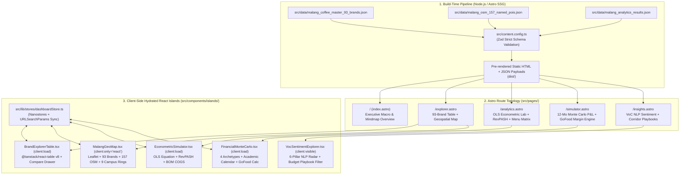
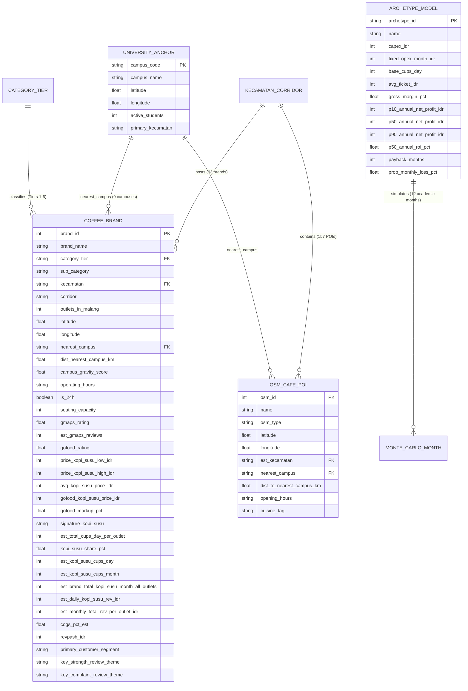

# PLAN: Malang Coffee Shop & Kopi Susu Market Intelligence Dashboard

Status: Accepted
Version: 1.0.0
Linked PRD: `PRD.md`

---

## Architecture

The application follows an **Astro Static-First Islands Architecture** (`output: 'static'`) where all static structural chrome, executive narrative, methodology documentation, and build-time data validation run at compile time, while high-interactivity modules hydrate independently as typed React 19 islands.



### Directory & Module Structure

```text
malang-coffee-intelligence/
├── astro.config.mjs                 # Astro + React + Tailwind v4 integration
├── package.json                     # Dependencies & verification scripts
├── tsconfig.json                    # TypeScript strict mode config
├── src/
│   ├── content.config.ts            # Astro Content Layer collections (brands, osmPois, analytics)
│   ├── data/
│   │   ├── malang_coffee_master_93_brands.json
│   │   ├── malang_osm_157_named_pois.json
│   │   ├── malang_universities_9_anchors.json
│   │   └── malang_analytics_results.json
│   ├── lib/
│   │   ├── types/
│   │   │   └── coffee-intelligence.ts     # Shared Zod-inferred TypeScript interfaces
│   │   ├── engines/
│   │   │   ├── ols-demand.ts              # Pure TS OLS regression & RevPASH calculator
│   │   │   ├── monte-carlo-pnl.ts         # 12-Month Academic Calendar P&L & ROI engine
│   │   │   ├── delivery-margin.ts         # GoFood / ShopeeFood / GrabFood markup calculator
│   │   │   ├── menu-engineering.ts        # BOM COGS & Star/Plowhorse quadrant classifier
│   │   │   └── geo-haversine.ts           # Haversine distance & campus gravity index math
│   │   ├── formatters.ts                  # Intl.NumberFormat('id-ID') IDR, %, compact formatters
│   │   └── stores/
│   │       └── dashboardStore.ts          # Nanostores + URLSearchParams synchronization
│   ├── components/
│   │   ├── layout/
│   │   │   ├── AppShell.astro             # 12-col analytical shell, sidebar/topbar, freshness badge
│   │   │   ├── KpiCard.astro              # Tabular-nums KPI card with delta & context badge
│   │   │   └── MindmapModal.astro         # Interactive architecture & taxonomy mindmap viewer
│   │   ├── ui/                            # shadcn/ui primitives (table, drawer, slider, badge, tabs)
│   │   └── islands/
│   │       ├── MacroChartsIsland.tsx      # Kecamatan & Tier bar/donut charts (Recharts)
│   │       ├── BrandExplorerTable.tsx     # TanStack Table v8 + 4-brand comparison + CSV/JSON export
│   │       ├── MalangGeoMap.tsx           # Leaflet map (93 brands, 157 OSM POIs, 9 campus rings)
│   │       ├── EconometricLabIsland.tsx   # OLS demand sliders + RevPASH + BOM COGS editor
│   │       ├── FinancialSimIsland.tsx     # 12-month academic cashflow + GoFood unit economics
│   │       └── VocPlaybookIsland.tsx      # 6-pillar review sentiment radar + corridor recommender
│   ├── pages/
│   │   ├── index.astro                    # Executive Macro Overview & Mindmap
│   │   ├── explorer.astro                 # 93-Brand Data Explorer & Geospatial Map
│   │   ├── analytics.astro                # Econometric Demand, RevPASH & Menu Engineering Lab
│   │   ├── simulator.astro                # 12-Month Monte Carlo P&L & Delivery Margin Simulator
│   │   └── insights.astro                 # VoC NLP Sentiment & Blue-Ocean Corridor Playbooks
│   └── styles/
│       └── global.css                     # Tailwind CSS + Okabe-Ito --chart-* tokens + tabular-nums
└── tests/
    ├── engines.test.ts                    # Vitest unit tests for OLS, RevPASH, GoFood, Monte Carlo
    └── schema.test.ts                     # Zod dataset integrity & completeness checks (93 brands)
```

---

## Platforms & Hosting

- **Runtime & Build Target:** Node.js `>= 22.x` at build time; static output (`dist/`) deployable to Cloudflare Pages, Vercel, or any static CDN edge.
- **Region & Latency Target:** Global edge CDN (Singapore `SIN` / Jakarta `CGK` PoP for Indonesian users).
- **Platform Constraints:** Zero server-side database dependencies at runtime; all 93-brand, 157-POI, and econometric simulation presets compile into static JSON chunks (`< 90KB` compressed).

---

## Auth, Roles & Authorization

| Role | May | May not | Enforced at |
|---|---|---|---|
| F&B Investor / Owner | Read all dashboards, run Capex/Monte Carlo simulations, bookmark/share scenario URLs, export filtered CSV/JSON | Mutate canonical dataset on server | Static build immutability (`output: 'static'`) |
| Franchise Expansion Lead | Filter 93 brands & 157 POIs, inspect 9 university buffer rings, compare up to 4 brands side-by-side, export corridor reports | Mutate canonical dataset on server | Static build immutability (`output: 'static'`) |
| Coffee Shop Operator / Store Manager | Run GoFood/ShopeeFood markup simulations, adjust BOM COGS grammage, benchmark RevPASH against local peers | Mutate canonical dataset on server | Static build immutability (`output: 'static'`) |
| Market Research Analyst | Query full 36-column telemetry table, inspect OLS regression parameters, export raw/filtered CSV and JSON | Mutate canonical dataset on server | Static build immutability (`output: 'static'`) |

*Note: v1.0 is an open/internal static analytical workstation with zero user-submitted personal data or server-side write endpoints.*

---

## Security & Privacy

- **Trust Boundaries:**
  - **Build-Time Data Boundary:** All JSON/CSV files in `src/data/` are validated by strict Zod schemas before HTML/JS generation (`REQ-001`, `REQ-002`).
  - **Client URL State Boundary:** Query parameters read from `window.location.search` (`kecamatan`, `tier`, `priceMax`, simulator numeric overrides) are parsed and clamped through Zod schemas (`z.coerce.number().min(...).max(...)`) before hydrating state; invalid query strings fall back safely to verified defaults without throwing or injecting DOM content.
- **Sensitive Data & Secrets:** Zero API keys, `.env` secrets, or personal customer PII exist in the repository or client bundle. Map tiles use keyless public OpenStreetMap / CartoDB Positron endpoints.

---

## Performance & Reliability Targets

| Target | Value | Linked requirement | How measured |
|---|---|---|---|
| Build-time dataset schema validation | `0` errors across 93 brands + 157 POIs | REQ-001, REQ-002 | `npm run build` (`astro check && astro build`) |
| Client-side table filter & sort response | `< 100 ms` p95 across 93 brands (36 cols) | REQ-004 | Browser Performance API / Vitest benchmark |
| Simulator recalculation latency (OLS / Monte Carlo / GoFood) | `< 16 ms` (single 60fps frame) | REQ-007, REQ-009, REQ-010 | Vitest execution timing + React render profile |
| Initial JS payload on Executive Overview (`/`) | `< 130 KB` gzipped | REQ-003, REQ-012 | `astro build` dist asset inspection |
| Cumulative Layout Shift (CLS) | `< 0.02` | REQ-003, REQ-006 | Reserved chart/map aspect containers (`min-h-[420px]`) |

---

## Environments & Delivery

- **Local Development:** `npm run dev` (`astro dev` on `http://localhost:4321`).
- **Verification & CI Gate:** `npm test` (`vitest run`) + `npm run build` (`astro check && astro build`) + `npm run preview` (`astro preview` verified with headless browser assertions).
- **Rollback Strategy:** Pure static artifact deployment; atomic instant rollback to the previous immutable build hash on CDN.

---

## Data Schema

### Entity-Relationship Diagram (`erDiagram`)



### Canonical Data Schema Table

| Table.field | Type | Required | Default | Index | Notes |
|---|---|---|---|---|---|
| `brands.brand_id` | `number` (int) | yes | — | PK | `1..93` unique identifier |
| `brands.brand_name` | `string` | yes | — | search | Includes *Haya Espresso Bar*, *Pesenkopi Plus*, *Jokolet*, *Lafayette*, etc. |
| `brands.category_tier` | `enum` | yes | — | facet | `Tier 1: National Grab-and-Go` .. `Tier 6: Destination & Heritage` |
| `brands.kecamatan` | `enum` | yes | — | facet | `Lowokwaru`, `Klojen`, `Blimbing`, `Sukun`, `Kedungkandang (Sawojajar)`, `Dau (Border)`, `Karangploso (Border)`, `Bumiaji (Batu Border)` |
| `brands.corridor` | `string` | yes | — | search | Micro-corridor (e.g., `Sawojajar / Danau Toba`, `Sudimoro`, `Suhat`) |
| `brands.outlets_in_malang` | `number` (int) | yes | `1` | sort | Physical outlets in Malang Raya (`1..26`, sum = `176`) |
| `brands.latitude` / `longitude` | `number` (float) | yes | — | spatial | WGS84 coordinates (`-8.05..-7.85`, `112.50..112.70`) |
| `brands.campus_gravity_score` | `number` (float) | yes | — | sort | $\sum_u \text{Students}_u / (d_{i,u}^2 + 0.15)$ |
| `brands.is_24h` | `boolean` | yes | `false` | facet | `true` for 24-hour hubs (+56.7 cups/day OLS premium) |
| `brands.seating_capacity` | `number` (int) | yes | — | sort | Seats per outlet (`10..400`) |
| `brands.gmaps_rating` | `number` (float) | yes | — | sort | `4.0..5.0` |
| `brands.est_gmaps_reviews` | `number` (int) | yes | — | sort | Verified review count (`100..15,000`) |
| `brands.avg_kopi_susu_price_idr` | `number` (int) | yes | — | filter/sort | Dine-in Kopi Susu price (`Rp10,000..Rp33,000`) |
| `brands.gofood_kopi_susu_price_idr` | `number` (int) | yes | — | sort | Delivery app Kopi Susu price (`Rp12,500..Rp40,000`) |
| `brands.est_kopi_susu_cups_day` | `number` (int) | yes | — | sort | Daily Kopi Susu cups per outlet (sum = `25,570`) |
| `brands.revpash_idr` | `number` (int) | yes | — | sort | Revenue Per Available Seat Hour (`Rp/seat-hr`) |
| `osmPois.osm_id` | `number` (int) | yes | — | PK | OpenStreetMap node/way ID (`157` named records) |
| `analytics.ols_regression` | `object` | yes | — | singleton | `r_squared: 0.7407`, `adj_r_squared: 0.7258`, `coefficients` array |
| `analytics.monte_carlo_archetypes` | `array` | yes | — | singleton | 4 store archetypes with P10/P50/P90 & 12-month seasonal multipliers |

---

## Data Ownership, Retention & Deletion

| Entity | Owner (role/tenant) | Retention | Deletion/anonymization |
|---|---|---|---|
| `brands` (93 commercial brands) | Repository Maintainer (`src/data/`) | Versioned in Git | Public commercial telemetry; no personal data stored |
| `osmPois` (157 OpenStreetMap POIs) | Repository Maintainer (`src/data/`, ODbL) | Versioned in Git | Public POI coordinates; attributed to OpenStreetMap contributors |
| Client Scenario State (`URLSearchParams` / `localStorage`) | Browser User (Client-local) | Session / User-controlled | Cleared via "Reset Scenario" button or browser storage clear |

---

## Migration & Seed

- **Seed Corpus Source:** Copied directly and idempotently from `~/Documents/work/research/malang-coffee-data/`:
  - `malang_coffee_master_93_brands.json` -> `src/data/malang_coffee_master_93_brands.json`
  - `malang_osm_157_named_pois.csv` (converted to typed JSON) -> `src/data/malang_osm_157_named_pois.json`
  - `malang_analytics_results.json` -> `src/data/malang_analytics_results.json`
- **Reversibility:** Pure static JSON seed files under Git version control; any dataset update can be reverted via `git revert` and validated via `npm test`.

---

## Integrations & Contracts

### Pure TypeScript Analytical Engines (`src/lib/engines/`)

1. **OLS Demand & RevPASH Engine (`src/lib/engines/ols-demand.ts`)**
   - **Formula:**
     $$\hat{Y}_{\text{KopiSusu/Day}} = \max\left(15, \text{round}\left(-238.767 + 0.331(\text{Seats}) + 56.703(\text{Is24H}) - 2.889\left(\frac{\text{Price}}{1000}\right) + 63.250\ln(\text{Reviews}) + 16.599\left(\frac{\text{Gravity}}{100}\right)\right)\right)$$
   - **RevPASH Formula:**
     $$\text{RevPASH} = \frac{\text{Total Daily Store Revenue (IDR)}}{\text{Seating Capacity} \times \text{Operating Hours/Day}}$$
   - **Diagnostic Thresholds:**
     - `RevPASH < Rp 2,500`: `DANGER — High Wi-Fi Squatting / Low Seat Turnover`
     - `Rp 2,500 <= RevPASH < Rp 4,500`: `HEALTHY — Balanced WFC & Dine-In Turnover`
     - `RevPASH >= Rp 4,500`: `HIGH VELOCITY — Grab & Go / High-Density Kopitiam`

2. **GoFood / ShopeeFood / GrabFood Unit Economics Engine (`src/lib/engines/delivery-margin.ts`)**
   - **Inputs:** `dineInPriceIdr`, `cogsIdr`, `packagingSealCostIdr` (default `Rp800`), `appMarkupPct` (`0..0.45`), `platformCommissionPct` (default `0.20`), `platformFixedFeeIdr` (default `Rp1,000`), `promoCoPayPct` (`0..0.30`).
   - **Outputs:**
     - `appListedPriceIdr = Math.round((dineInPriceIdr * (1 + appMarkupPct)) / 500) * 500`
     - `platformCutIdr = appListedPriceIdr * platformCommissionPct + platformFixedFeeIdr`
     - `promoSubsidyIdr = appListedPriceIdr * promoCoPayPct`
     - `netMerchantPayoutIdr = appListedPriceIdr - platformCutIdr - promoSubsidyIdr`
     - `netContributionIdr = netMerchantPayoutIdr - (cogsIdr + packagingSealCostIdr)`
     - `recommendedMarkupPct`: exact markup required so `netContributionIdr >= dineInPriceIdr - cogsIdr`.

3. **12-Month Academic Calendar Cashflow Engine (`src/lib/engines/monte-carlo-pnl.ts`)**
   - Applies monthly Malang academic seasonality multipliers (`Jan: 0.78`, `Feb: 0.74`, `Mar: 1.05`, `Apr: 1.08`, `May: 1.12`, `Jun: 1.04`, `Jul: 0.72`, `Aug: 0.76`, `Sep: 1.18`, `Oct: 1.15`, `Nov: 1.14`, `Dec: 0.96`) with toggleable neighborhood immunization (`Sawojajar / Sulfat` commuter dampening factor `0.5x` on holiday drops).

---

## Risks & Mitigations

| Risk | Severity | Mitigation |
|---|---|---|
| Leaflet accesses `window` during Astro SSR build and crashes `astro build` | High | Render `MalangGeoMap.tsx` strictly with `client:only="react"` and reserve a fixed `min-h-[520px]` skeleton container in `explorer.astro` |
| Hydration mismatch when initializing filters from `URLSearchParams` | Medium | Read `URLSearchParams` inside a `useEffect` hook post-mount (or initialize synchronously on `client:only` islands) while rendering deterministic static defaults on initial SSR pass |
| Wide 36-column table causes horizontal page overflow on 1280px laptops | Medium | Default visible columns to the 10 highest-signal metrics (`Brand`, `Kecamatan`, `Corridor`, `Tier`, `Price`, `Kopi Susu/Day`, `RevPASH`, `Rating`, `Reviews`, `24H`), with a "Columns" visibility toggle and expandable row / comparison drawer for all 36 attributes |
| Colorblind users cannot distinguish Category Tiers or Margin Status on charts/maps | Medium | Enforce the 8-color Okabe-Ito palette (`--chart-1`..`--chart-8`) paired with distinct badge labels, shapes, and direct value annotations |
