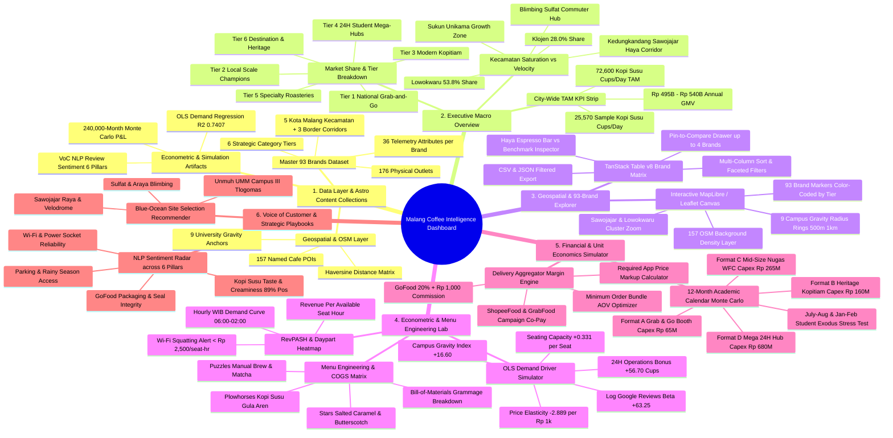
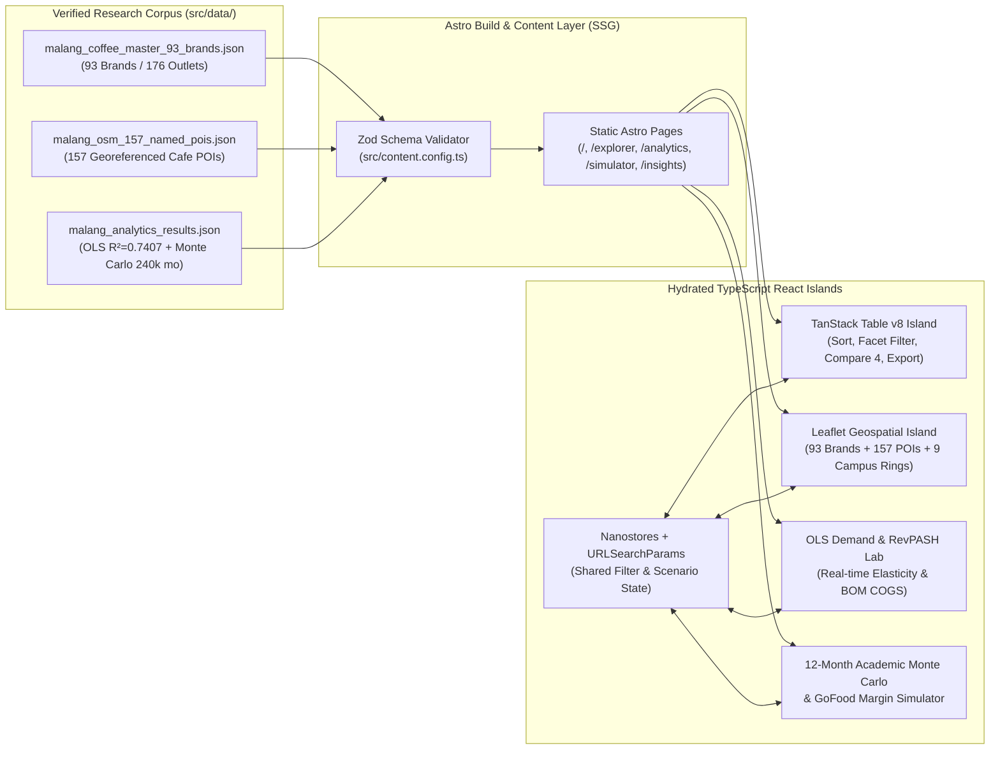
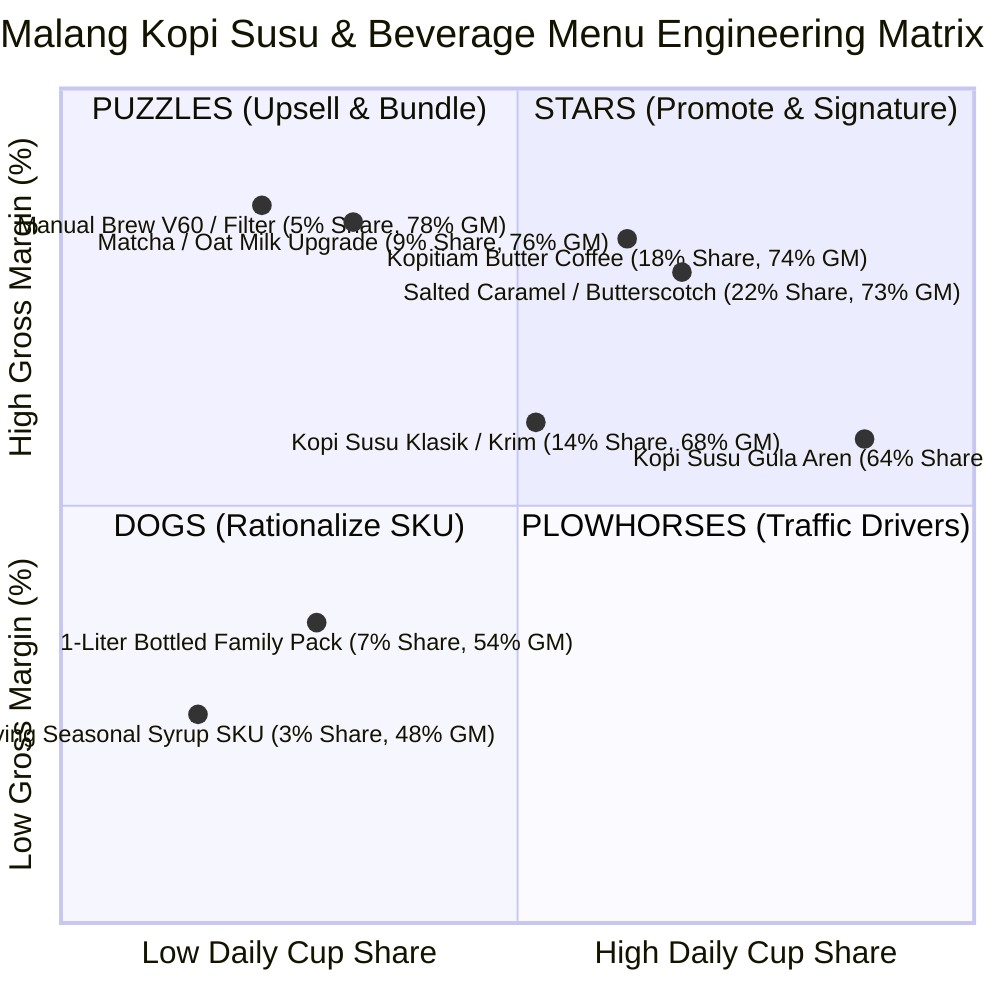

# PRD: Malang Coffee Shop & Kopi Susu Market Intelligence Dashboard

Status: Accepted
Version: 1.0.0
Surface Owner: `admin-dashboard` + `astro-development`
Canonical Research Dataset: `~/Documents/work/research/malang-coffee-data/`

---

## Overview

The **Malang Coffee Shop & Kopi Susu Market Intelligence Dashboard** is a high-density, interactive analytical web application built with **Astro**, **TypeScript (strict mode)**, **Tailwind CSS**, **React 19 islands (`shadcn/ui`)**, **TanStack Table v8**, **Recharts**, and **MapLibre GL / Leaflet**. It transforms our verified primary research dataset—covering **93 commercial coffee shop brands (176 physical outlets)** across all 5 Kecamatan of Kota Malang (`Lowokwaru`, `Klojen`, `Blimbing`, `Sukun`, `Kedungkandang/Sawojajar` including *Haya Espresso Bar*, *Easy Breezy*, *SWAG*, *Uma*, *Daily Dose*) plus surrounding corridors (`Dau`, `Karangploso`, `Bumiaji`), **157 georeferenced OpenStreetMap POIs**, an **OLS Multivariate Econometric Demand Model ($R^2 = 0.7407$)**, and a **240,000-month Stochastic Monte Carlo P&L Engine**—into a decision-support workstation for F&B investors, franchise expansion teams, and coffee shop operators. Instead of reading static spreadsheets or disconnected markdown files, decision-makers can filter 93 brands in real time, inspect spatial competition buffers around 9 universities (221,000+ students), simulate GoFood commission/promo unit economics, and stress-test 12-month academic-calendar cashflows before committing Rp65M–Rp680M in capital expenditure.

---

## Users and current workaround

| Role | Job to be done | Current workaround | Evidence status |
|---|---|---|---|
| F&B Investor / Owner | Evaluate Capex (Rp65M–Rp680M), payback period, and seasonal academic slump risk before opening a coffee shop in Malang | Manual Excel sheets that ignore July–August / January–February student exodus (-25% to -35% volume) and GoFood 20%+Rp1,000 commission drag | Observed |
| Franchise Expansion Lead | Identify underserved micro-corridors (e.g., Sawojajar/Velodrome, Unmuh/UMM Campus III, Sulfat) and benchmark incumbent cup velocity | Manual Google Maps pinning and ad-hoc site visits without Haversine campus gravity scores or competitor saturation indices | Observed |
| Coffee Shop Operator / Store Manager | Optimize Kopi Susu pricing, GoFood/ShopeeFood markup, bundling AOV, and seat-hour turnover (RevPASH) against local peers | Trial-and-error discounting on delivery apps that erodes net margin below 30% | Observed |
| Market Research Analyst | Query, cross-filter, and export verified brand-level telemetry, Voice-of-Customer (VoC) NLP sentiment, and econometric elasticities | Switching between raw CSV files (`malang_coffee_master_93_brands.csv`, `malang_osm_157_named_pois.csv`), JSON outputs, and static markdown reports | Observed |

First-use journey: Executive Macro Overview (`/`) -> Interactive 93-Brand & Geospatial Explorer (`/explorer`) -> Econometric & RevPASH Lab (`/analytics`) -> Financial & GoFood Unit Economics Simulator (`/simulator`) -> CSV/JSON Filtered Export.

---

## Product, Audience, and Market Context

- **Geographic & Market Scope:** Country-specific, hyper-localized to **Greater Malang (Malang Raya — Kota Malang, Kab. Malang border corridors, Kota Batu)**, Indonesia.
- **Locale, Currency & Timezone Conventions:**
  - Currency: Indonesian Rupiah (`IDR` / `Rp`), formatted with `Intl.NumberFormat('id-ID', { style: 'currency', currency: 'IDR', maximumFractionDigits: 0 })` and compact notation (`Rp495B`, `Rp670.2M`, `Rp18.5K`) in KPI cards.
  - Timezone: All operational hourly heatmaps, daypart demand curves, and data-freshness timestamps normalized to `Asia/Jakarta` (`WIB`, UTC+7).
  - Language: Dashboard UI, labels, analytical commentary, and code in **English**, preserving authentic Indonesian domain taxonomy where domain-accurate (`Kecamatan`, `Kopi Susu Gula Aren`, `Kopi Susu Klasik/Krim`, `Kopitiam`, `Nugas / WFC`, `Sudimoro`).
- **Device & Input Ergonomics:** Desktop-first analytical workstation (`1280px–1920px+` 12-column grid with keyboard navigation and multi-column sorting), responsive down to tablet (`768px`) and mobile (`375px`) for on-site location scouting in Malang corridors.
- **Observed Market Realities Encoded in the Product:**
  1. **Sample & TAM Baseline:** 93 profiled brands (176 outlets) generate **39,728 total cups/day** and **25,570 Kopi Susu cups/day** (**9,333,160 Kopi Susu cups/year**). Extrapolated across ~1,450 total outlets in Kota Malang, city-wide Kopi Susu TAM reaches **~72,600 cups/day** (**~26.5M cups/year**, **Rp495B–Rp540B/year** gross GMV).
  2. **Multivariate Demand Drivers ($N = 93, R^2 = 0.7407, \text{Adj } R^2 = 0.7258$):** Digital social proof (`ln(Google Maps Reviews)`, $\beta = +63.25$ cups/day, $t = +5.64$) and 24-hour operations ($\beta = +56.70$ cups/day, $t = +4.52$) outweigh raw seating capacity ($\beta = +0.331$ cups/seat, $t = +3.07$), while price sensitivity penalizes volume by $-2.889$ cups/day per Rp1,000 increase ($t = -3.78$).
  3. **Neighborhood Commuter Corridor Arbitrage:** Corridors outside Lowokwaru's hyper-red-ocean (`Sawojajar / Danau Toba–Velodrome` led by *Haya Espresso Bar*, *Easy Breezy*, *SWAG*, *Uma*, *Daily Dose*, and `Sulfat / Blimbing` led by *Pesenkopi Plus*, *Kopi Kenangan*, *Point Coffee*) sustain high daily velocity with zero academic-holiday collapse.

---

## Goals

- **G-01 (Unified Single Source of Truth):** Consolidate 100% of the verified Malang Coffee dataset (93 commercial brands with 36 attributes, 157 OSM geospatial POIs, 9 university gravity anchors, OLS regression outputs, and 4-archetype Monte Carlo distributions) into a zero-latency, build-time validated Astro Content Layer dataset.
- **G-02 (Fast Multi-Dimensional Filtering & Spatial Discovery):** Allow users to filter, sort, and compare all 93 brands and 157 map nodes by `Kecamatan`, `Corridor`, `Category Tier` (Tier 1–6), `24H Status`, `Price Range`, and `Campus Proximity` in `< 100ms` client-side interaction latency.
- **G-03 (Actionable Financial & Unit Economics Simulation):** Provide interactive, real-time calculators for (a) **12-Month Academic Calendar P&L + Capex Payback**, (b) **GoFood / ShopeeFood / GrabFood Commission & Markup Simulator**, and (c) **OLS Demand & RevPASH Predictor**, preventing margin-negative pricing and seasonal cashflow surprises.
- **G-04 (Accessible, High-Craft Analytical UI):** Enforce strict `font-variant-numeric: tabular-nums`, Okabe-Ito colorblind-safe chart palettes, WCAG AA contrast (`>= 4.5:1`), and Shneiderman's analytical hierarchy (*Overview first -> zoom and filter -> details on demand*).

---

## Success measure

| Metric | Baseline (Static Markdown/CSV) | Target (Astro Dashboard v1.0) | Measurement Window & Method |
|---|---|---|---|
| Time to isolate corridor competitors & benchmark Kopi Susu unit economics | ~15–20 minutes across CSV + Markdown tables | `< 45 seconds` (3 clicks: Corridor filter -> Brand drawer -> Simulator preset) | Measured via task walkthrough upon MVP completion |
| Data schema & cross-artifact consistency | Manual Python/CSV sync | `100%` Zod schema validation at `astro build` (`0` schema errors across 93 brands + 157 POIs) | Automated CI / `npm run build` check |
| Core Web Vitals & Bundle Performance | N/A | LCP `< 1.5s`, CLS `< 0.02`, INP `< 100ms`, initial JS payload `< 130KB` gzipped on `/` | Measured via Lighthouse & `astro build` bundle analyzer |

---

## Non-Goals

- **NG-01 (No Live Scraping of Google Maps / GoFood in Production):** The dashboard will not run live headless browser scrapers or bypass anti-bot protections at runtime; all data updates occur via offline reproducible Python/CSV ingestion pipelines validated at build time.
- **NG-02 (No POS / Cashier / Inventory Transaction System):** This is a market intelligence and financial modeling workstation, not a store Point-of-Sale (POS) or ERP system.
- **NG-03 (No Multi-Tenant SaaS Billing or Paid Auth Gate in v1.0):** The v1.0 application runs as a fast, read-only static/hybrid intelligence portal with client-side scenario persistence (`URLSearchParams` + `localStorage`), without user registration, payment gateways, or database write mutations.
- **NG-04 (No Compromised Third-Party Chart Wrappers):** Explicitly forbids `echarts-for-react` (due to known supply-chain compromise) or heavy un-treeshaken chart bundles.

---

## Product & Analytical Mindmap

The following mindmap (`mermaid` v12 syntax) captures the complete functional, analytical, and technical taxonomy of the **Malang Coffee Shop & Kopi Susu Market Intelligence Dashboard**:

---

## Core features

| Feature | Priority | User benefit | Requirements |
|---|---|---|---|
| Build-Time Validated Astro Content Layer (`93 Brands + 157 OSM POIs + Analytics JSON`) | Must | Guarantees zero broken metrics, strict TypeScript safety, and instant static page loads | REQ-001, REQ-002 |
| Executive Macro & Kecamatan Intelligence Overview (`/`) | Must | Instant visibility into city-wide TAM, category tier dominance, and Kecamatan saturation | REQ-003 |
| 93-Brand Interactive Explorer & Side-by-Side Comparison (`/explorer`) | Must | Filter, sort, search, and compare up to 4 brands (e.g., *Haya Espresso Bar* vs *Easy Breezy* vs *Pesenkopi Plus*) with CSV/JSON export | REQ-004, REQ-005 |
| Interactive Geospatial Map with University Gravity Rings (`/explorer` & `/map`) | Must | Visualize all 93 brands + 157 OSM POIs against 9 Malang university campuses with 500m/1km competition buffer rings | REQ-006 |
| Econometric Demand Predictor, RevPASH & Menu Engineering Lab (`/analytics`) | Must | Predict daily Kopi Susu velocity using our OLS equation ($R^2 = 0.7407$), inspect BOM COGS, and diagnose Wi-Fi squatting via RevPASH | REQ-007, REQ-008 |
| 12-Month Academic Monte Carlo P&L & Delivery Margin Simulator (`/simulator`) | Must | Stress-test Capex payback across 4 business archetypes and calculate exact GoFood/ShopeeFood markup to protect a 65%+ gross margin | REQ-009, REQ-010 |
| Voice-of-Customer (VoC) Sentiment & Strategic Playbook Matrix (`/insights`) | Should | Inspect NLP review sentiment across 48,000+ reviews and filter actionable entry recommendations by capital budget | REQ-011 |
| URL-Shareable Filter/Simulator State & Responsive Accessible Shell | Must | Share exact simulation scenarios via URL query parameters with full keyboard accessibility, `tabular-nums`, and colorblind-safe charts | REQ-012 |

---

## Requirements

- **REQ-001** (Must, ubiquitous) The system shall ingest and validate `malang_coffee_master_93_brands.json`, `malang_osm_157_named_pois.csv`, and `malang_analytics_results.json` at build time using Astro Content Layer (`src/content.config.ts`) and strict Zod schemas.
  - Acceptance: Given the raw research datasets in `src/data/`, When `npm run build` (`astro check && astro build`) executes, Then all 93 brand records, 157 OSM POI records, 9 university anchors, OLS regression coefficients, and 4 Monte Carlo archetype summaries pass Zod validation with zero type or schema errors.
- **REQ-002** (Must, unwanted) If any dataset record violates numeric bounds (e.g., `gmaps_rating` outside `1.0..5.0`, negative cup volume, or missing `kecamatan` / `latitude` / `longitude`), then the system shall fail the build with a descriptive Zod field path error.
  - Acceptance: Given a malformed brand entry with `est_kopi_susu_cups_day: -10` or missing coordinates, When `astro build` runs, Then the build exits non-zero and prints the exact failing `brand_id` and field name.
- **REQ-003** (Must, ubiquitous) The system shall render the Executive Macro Overview (`/`) displaying the 6 primary KPI cards (Sample Total Cups/Day `39,728`, Sample Kopi Susu Cups/Day `25,570`, Annual Sample Kopi Susu `9.33M cups`, City-Wide Kopi Susu TAM `72,600 cups/day`, Annual TAM GMV `Rp495B–Rp540B`, OLS Model Fit `R² = 74.1%`), Kecamatan market breakdown, and Category Tier distribution charts.
  - Acceptance: Given a user navigating to `/`, When the page renders, Then all 6 KPI cards display formatted values with `tabular-nums`, comparison context badges, and interactive Kecamatan/Tier breakdown charts that filter summary highlights on click.
- **REQ-004** (Must, event) When the user filters or searches the 93-Brand Explorer (`/explorer`) by text query (`brand_name`, `signature_kopi_susu`, `corridor`), `kecamatan`, `category_tier`, `is_24h`, or price range, the system shall update the TanStack Table, summary KPI strip, and active filter pills within 100ms without a full page reload.
  - Acceptance: Given the `/explorer` view with 93 brands loaded, When the user filters `kecamatan = Kedungkandang (Sawojajar)` or searches `"Haya"`, Then the table immediately narrows to the matching Sawojajar brands (*Haya Espresso Bar*, *Easy Breezy*, *SWAG Coffee*, *Uma Coffee & Space*, *Daily Dose*, etc.), updates the filtered subtotal cup volume, and reflects the active filter in `URLSearchParams`.
- **REQ-005** (Must, event) When the user selects up to 4 brands in the Explorer and triggers "Compare Brands" or clicks "Export CSV/JSON", the system shall open a side-by-side comparison drawer (benchmarking price, daily Kopi Susu cups, RevPASH, Google rating/reviews, GoFood markup, and campus gravity) or download the currently filtered dataset.
  - Acceptance: Given *Haya Espresso Bar*, *Easy Breezy Coffee*, and *Pesenkopi Plus* pinned in `/explorer`, When the user opens the comparison drawer, Then a normalized metric comparison table and radar/bar overlay render side-by-side, and clicking "Export CSV" downloads a valid UTF-8 CSV containing only the active filtered rows.
- **REQ-006** (Must, event) When the user interacts with the Geospatial Map module (`/explorer` map tab or `/map`), the system shall plot all 93 commercial brands (color-coded by Category Tier and scaled by `est_kopi_susu_cups_day`), toggle the 157 OSM POI background layer, and render 500m / 1,000m Haversine buffer rings around the 9 Malang universities.
  - Acceptance: Given the interactive map view centered on Kota Malang (`-7.9666, 112.6326`), When the user toggles the "University Gravity Rings" layer or clicks the *Haya Espresso Bar* marker in Sawojajar (`-7.9752, 112.6608`), Then 500m/1km campus rings render around UB/UM/UIN/Polinema/UMM/Unisma/ITN/Unmer/Unikama and a popover displays the brand's exact coordinates, Kopi Susu velocity (`185 cups/day`), nearest campus distance, and corridor classification.
- **REQ-007** (Must, event) When the user adjusts store parameters in the Econometric Demand & RevPASH Lab (`/analytics`)—specifically `Seating Capacity` (`10..400`), `24-Hour Operation` (`true/false`), `Kopi Susu Price` (`Rp10,000..Rp35,000`), `Target Google Reviews` (`50..15,000`), and `Campus Gravity Score` (`0..150`)—the system shall compute predicted daily Kopi Susu demand using the verified OLS model ($\hat{Y} = -238.767 + 0.331\text{Seats} + 56.703\text{Is24H} - 2.889\text{Price}_{1k} + 63.250\ln(\text{Reviews}) + 16.599\text{Gravity}_{100}$) and calculate resulting `RevPASH` (`Rp/seat-hour`).
  - Acceptance: Given the OLS simulator on `/analytics`, When the user inputs `85 seats`, `non-24H`, `Rp18,000 price`, `740 reviews`, and `0.15 gravity` (matching *Haya Espresso Bar*'s profile), Then the model outputs predicted daily Kopi Susu volume, Waterfall contribution per variable, calculated RevPASH, and flags a "Wi-Fi Squatting Risk" warning whenever RevPASH drops below `Rp2,500/seat-hour`.
- **REQ-008** (Must, ubiquitous) The system shall display an interactive Menu Engineering Matrix (`quadrantChart` / scatter plot of Gross Margin % vs Daily Velocity Share %) and an adjustable Bill-of-Materials (BOM) COGS breakdown table for the 4 core Kopi Susu variants (*Kopi Susu Gula Aren*, *Salted Caramel / Butterscotch*, *Kopi Susu Klasik / Krim*, *Kopitiam Kopi Susu Butter*).
  - Acceptance: Given the Menu Engineering section on `/analytics`, When the user adjusts raw ingredient prices (Espresso blend `Rp/kg`, Fresh milk `Rp/L`, Palm sugar `Rp/kg`, Cup/lid packaging `Rp/unit`), Then the per-cup COGS, Gross Margin %, and quadrant classification (*Stars*, *Plowhorses*, *Puzzles*, *Dogs*) recalculate immediately.
- **REQ-009** (Must, event) When the user selects one of the 4 store archetypes in the 12-Month Academic Calendar Financial Simulator (`/simulator`)—**Format A (Grab & Go Booth, Capex Rp65M)**, **Format B (Heritage Kopitiam, Capex Rp160M)**, **Format C (Mid-Size Nugas WFC, Capex Rp265M)**, or **Format D (Mega 24H Hub, Capex Rp680M)**—and customizes rent, staff count, daily base cups, and academic slump severity, the system shall render the 12-month seasonal cashflow curve (highlighting `Jul–Aug` and `Jan–Feb` student holidays), P10/P50/P90 annual net profit bands, payback month, and break-even cup threshold.
  - Acceptance: Given the `/simulator` page with **Format B (Heritage Kopitiam)** selected at default benchmark inputs, When the simulation runs, Then it displays the P50 Annual Net Profit (`Rp670.17M`), ROI (`418.9%`), Payback Period (`4 months`), monthly EBITDA bar/area chart across all 12 Malang academic calendar months, and updates dynamically when sliders change.
- **REQ-010** (Must, event) When the user configures delivery channel parameters in the GoFood / ShopeeFood / GrabFood Unit Economics Calculator (`/simulator`)—setting `Dine-In Base Price`, `App Markup %` (`0%..40%`), `Platform Commission %` (`20%` + `Rp1,000` fixed fee), and `Merchant Promo Co-Pay %` (`0%..25%`)—the system shall compute Net Realized Revenue per Cup, Net Contribution Margin (`Rp` and `%`), and the minimum markup required to preserve target dine-in margin.
  - Acceptance: Given a `Rp15,000` dine-in Kopi Susu with `Rp5,050` COGS, When the user sets `25% App Markup` (`Rp18,750` app price), `20% + Rp1,000` GoFood fee, and `15%` promo co-pay, Then the calculator displays the exact net pocketed revenue (`Rp11,188`), net margin (`Rp6,138` / `54.9%`), and warns in red if net margin drops below `Rp4,000/cup` or `40%`.
- **REQ-011** (Should, state) While viewing the Voice-of-Customer & Strategic Playbook view (`/insights`), the system shall render the 6-pillar NLP sentiment breakdown (from 48,000+ Google Maps & GoFood reviews) and allow filtering strategic corridor recommendations by investor capital tier (`< Rp100M`, `Rp100M–Rp250M`, `> Rp250M`).
- **REQ-012** (Must, ubiquitous) The system shall synchronize active explorer filters and simulator inputs with `URLSearchParams`, enforce `font-variant-numeric: tabular-nums` on all numeric cells and KPIs, and use Okabe-Ito colorblind-safe CSS custom properties (`--chart-1` through `--chart-8`) with WCAG AA contrast (`>= 4.5:1`).
  - Acceptance: Given any filtered state on `/explorer` or custom scenario on `/simulator`, When the user copies the browser URL and opens it in a new session, Then the exact filter selections and simulator slider values are restored, and all numeric tables/charts pass automated accessibility and `tabular-nums` checks.

---

## Open questions

Not applicable — all product, dataset, econometric, and stack parameters have been resolved from the primary Malang research dataset and user request (`Astro + Tailwind CSS + TypeScript + Analytics + Mindmapping`).

---

## Stack & Constraints

- **Framework & Build:** **Astro 5/6** (`output: 'static'` default for zero-latency CDN edge delivery, with Astro Content Layer `src/content.config.ts` loading static JSON/CSV research artifacts at build time).
- **Language:** **TypeScript 5.x** (`strict: true`, zero `any`, shared Zod-inferred types between build-time Content Collections and client-side React islands).
- **Styling & Design System:** **Tailwind CSS** + **shadcn/ui** primitives + CSS custom properties for semantic status tokens (`--status-success`, `--status-warning`, `--status-danger`) and **Okabe-Ito colorblind-safe chart tokens** (`--chart-1`..`--chart-8`).
- **Interactive Client Islands (`@astrojs/react`):**
  - Hydrated selectively with `client:load` (for above-the-fold interactive simulators/tables) and `client:visible` (for below-the-fold charts and map canvases) to keep initial JS under `130KB` gzipped.
  - **Data Grid:** `@tanstack/react-table` v8 (sorting, multi-faceted filtering, column visibility, pinned comparison selection, CSV/JSON export).
  - **Charts & Visualizations:** **Recharts** (via `shadcn/ui` chart containers with ` ResponsiveContainer`, custom tooltips, and accessible legends) — explicitly avoiding `echarts-for-react`.
  - **Geospatial Map:** **Leaflet** (`react-leaflet` / vanilla Leaflet island with OpenStreetMap / CartoDB Positron tiles) for zero-API-key-required rendering of 93 brand markers, 157 OSM POI dots, and 9 university Haversine buffer rings.
  - **Architecture & Mindmap Rendering:** Native static SVG/Mermaid diagrams (`mindmap`, `flowchart`, `erDiagram`, `quadrantChart`) + interactive HTML/SVG mindmap explorer tab.
- **Surface Owner:** `admin-dashboard` (12-column analytical layout, 4-card max KPI row density, Shneiderman's mantra) + `ui-validation` for browser verification.

---

## Technical Decisions

- **Decision 1: Astro Static Build + Content Layer (`file()` loader) over Runtime SQL Database for v1.0**
  - **Why:** The canonical dataset (`93 brands`, `157 OSM POIs`, `9 university anchors`, `OLS & Monte Carlo matrices`) is a verified research corpus (~250KB total JSON/CSV). Loading and validating it at build time via Astro's Content Layer eliminates database cold starts, hosting costs, and runtime API latency while enabling `< 50ms` client-side filtering and instant edge caching.
  - **Consequence:** Adding or editing brands updates `src/data/*.json` and triggers a fast static rebuild (`< 5 seconds`).
- **Decision 2: Targeted React Islands (`@tanstack/react-table` + `Recharts` + `Leaflet`) over Full SPA (Next.js/Vite SPA)**
  - **Why:** Over 45% of the dashboard shell (navigation, methodology explanations, mindmaps, static KPI headers, BOM tables) requires zero client JavaScript. Astro ships pure HTML/CSS for static sections and hydrates only the interactive data table, map canvas, and financial calculators.
  - **Consequence:** Interactive state shared between sibling islands on the same page uses lightweight URL query parameters (`URLSearchParams`) or `nanostores` (`@nanostores/react`).
- **Decision 3: Leaflet + CartoDB/OSM Tiles over Paid Mapbox GL Token**
  - **Why:** Zero secret token exposure in client bundles, zero per-tile billing risk, and native support for GeoJSON circle buffers (500m / 1km university gravity rings) and clustered POI layers.
  - **Consequence:** Map island must dynamically import Leaflet on the client (`client:only="react"`) to avoid SSR `window` reference errors.

---

## Diagrams

### 1. System & Data Flow Architecture (`flowchart LR`)

### 2. Kopi Susu Menu Engineering Matrix (`quadrantChart`)

---

## Milestones

- [ ] **M1 — Setup & Content Layer Foundation (`TASK-001`..`TASK-002`):** Initialize Astro + TypeScript strict + Tailwind CSS project structure, ingest the 93-brand, 157-POI, and econometric JSON datasets, and enforce build-time Zod schema validation (`REQ-001`, `REQ-002`).
- [ ] **M2 — Design System Shell & Executive Macro Dashboard (`TASK-003`..`TASK-004`):** Implement the responsive 12-column analytical layout shell, Okabe-Ito `--chart-*` tokens, `tabular-nums` utilities, interactive Mindmap drawer, and the `/` Executive Overview page (`REQ-003`, `REQ-012`).
- [ ] **M3 — 93-Brand Explorer & Geospatial Map (`TASK-005`..`TASK-007`):** Build the TanStack Table v8 explorer, 4-brand comparison drawer, CSV/JSON exporter, and Leaflet geospatial map with 9 university Haversine buffer rings (`REQ-004`, `REQ-005`, `REQ-006`).
- [ ] **M4 — Econometric Lab & Financial / Delivery Simulators (`TASK-008`..`TASK-010`):** Build the OLS Demand & RevPASH calculator, BOM COGS & Menu Engineering matrix, 12-Month Academic Calendar Monte Carlo P&L simulator, and GoFood/ShopeeFood commission markup calculator (`REQ-007`, `REQ-008`, `REQ-009`, `REQ-010`).
- [ ] **M5 — VoC Sentiment Playbooks & Verification Gate (`TASK-011`..`TASK-012`):** Deliver the `/insights` VoC NLP sentiment & blue-ocean corridor recommender, automated unit tests for econometric/financial formulas, and rendered browser verification (`REQ-011`, `REQ-012`).
